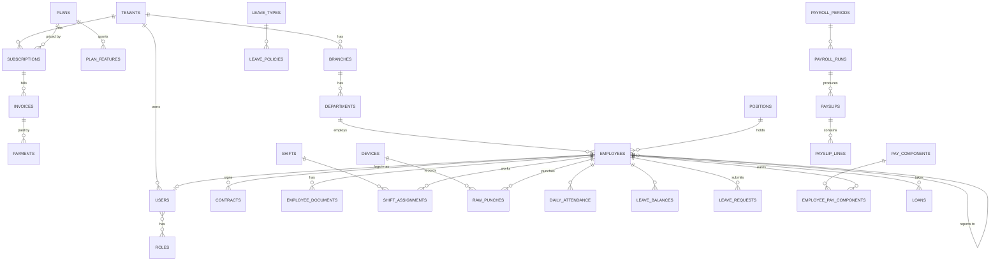

# HR SaaS (Egypt) — Architecture & Design

Status: draft v0.1 · 2026-10-20

A multi-tenant, subscription-based HR system (core HR, attendance, leave, payroll) built for Egyptian
employers and compliant with Egyptian labour, social-insurance and tax law. Backend first (Java / Spring Boot);
web (React) and mobile (React Native) clients come later and consume the same REST API.

---

## 1. Decisions

| Topic | Decision | Why |
|---|---|---|
| Architecture | **Modular monolith** (Spring Modulith) | One deployable, strict module boundaries verified by tests; modules can be split into services later if one needs to scale independently (most likely candidates: attendance ingestion, payroll runs). |
| Tenancy | **Shared DB, shared schema, `tenant_id` on every tenant table** | Cheapest to operate, single migration path, scales to thousands of SME tenants. Isolation enforced twice: Hibernate `@TenantId` + PostgreSQL Row-Level Security. |
| Language / runtime | Java 25 (LTS), Spring Boot 4.1 | Virtual threads, records, pattern matching; Boot 4 = Spring Framework 7, Hibernate 7, Jakarta EE 11. |
| Build | Maven 3.9 (wrapper committed) | |
| Database | PostgreSQL 17+ | RLS, JSONB, partitioning for punch logs, strong numeric types for money. |
| Migrations | Flyway | Versioned SQL, run by a privileged role; the app runs as a non-owner role so RLS applies. |
| Auth | Spring Security + JWT (OAuth2 resource server, HS256/RS256), refresh tokens in DB | No external IdP to operate. Keycloak/SSO can be added later for enterprise plans. |
| API | REST, JSON, `/api/v1/**`, OpenAPI 3 (springdoc) | Contract for React / React Native clients. |
| i18n | Arabic + English | Bilingual master data (`name_en`, `name_ar`), `Accept-Language` for messages, Arabic payslips / official forms. |
| Payments | Pluggable `PaymentGateway` SPI: cards, mobile wallets, Fawry reference codes, bank transfer | Paymob and FawryPay adapters first; manual bank transfer always available. |
| Money | `BigDecimal` / `numeric(14,2)`, currency EGP, rounding HALF_UP at defined points only | |

---

## 2. Technology stack

| Layer | Choice |
|---|---|
| Web | Spring Web MVC on virtual threads, Bean Validation, `ProblemDetail` (RFC 9457) errors |
| Persistence | Spring Data JPA (Hibernate 7), Flyway, PostgreSQL |
| Modularity | Spring Modulith (module verification, application events, event publication registry) |
| Security | Spring Security 7, OAuth2 Resource Server (JWT), BCrypt/Argon2 password hashing |
| Async / jobs | Modulith events (transactional outbox) now; JobRunr or Quartz for scheduled jobs (payroll runs, subscription renewals, attendance processing) |
| Cache | Caffeine in-process; Redis when running >1 instance (rate limits, token denylist) |
| Files | S3-compatible object storage (MinIO in dev) for documents, payslip PDFs, selfies |
| Reports / PDFs | JasperReports or OpenHTMLtoPDF with Arabic fonts (RTL shaping) |
| Excel import/export | Apache POI / FastExcel |
| Observability | Actuator, Micrometer → Prometheus/Grafana, OpenTelemetry tracing, structured JSON logs with `tenantId` in MDC |
| Testing | JUnit 5, Testcontainers (Postgres), Modulith `ApplicationModules.verify()`, ArchUnit |
| Packaging | Docker image (Buildpacks via `spring-boot:build-image`), docker-compose for dev; Kubernetes later |

---

## 3. Module map

```
com.hrsaas
├── shared          kernel: tenant context, base entity, errors, i18n, money, time  (open module)
├── platform        tenants, platform admins                                 [platform tables]
├── identity        sign-up, users, roles, permissions, login, JWT, refresh tokens [tenant tables]
├── billing         plans, features, subscriptions, invoices, payments      [platform tables]
├── organization    company profile, branches, departments, positions,
│                   cost centers, work calendars, shifts, public holidays
├── employee        employee master file, contracts, documents, dependants,
│                   bank accounts, insurance data, lifecycle (hire → exit)
├── attendance      devices, raw punches, geofences, daily records,
│                   lateness / absence / overtime calculation
├── leave           leave types, policies, balances, requests, approvals
├── payroll         pay components, salary structures, payroll periods/runs,
│                   payslips, loans/advances, bank file export
├── compliance      Egyptian statutory engine: effective-dated parameters
│                   (insurance %, wage caps, tax brackets, minimum wage),
│                   calculators, official forms (Form 1/2/6), ETA reports
├── workflow        generic approval chains (leave, overtime, loans, corrections)
├── notification    email / SMS / push / in-app, templated (AR/EN)
└── reporting       read models, exports, dashboards
```

Rules (enforced by `ModularityTests`):

* Modules talk through their **public API package** (top-level package) or **application events**; `internal`
  sub-packages are private.
* Cross-module writes go through events, e.g. `LeaveApproved` → attendance marks the days as leave,
  payroll picks up unpaid leave deductions; `EmployeeHired` → leave creates balances.
* `compliance` never depends on `payroll`; payroll calls compliance calculators.
* `billing` exposes `FeatureGate` / `@RequiresFeature`; other modules never read subscription tables.

---

## 4. Multi-tenancy

**Platform tables** (no `tenant_id`, no RLS): `tenants`, `plans`, `plan_features`, `subscriptions`,
`invoices`, `payments`, `statutory_parameters`, `platform_admins`.

**Tenant tables**: everything else. Each has `tenant_id uuid not null` and is the first column of every
composite index / unique constraint (e.g. `unique (tenant_id, email)`).

Enforcement layers:

1. **Request → TenantContext.** Authenticated requests: tenant comes from the JWT `tid` claim (never from a
   header). Unauthenticated requests that need a tenant (login, password reset) pass the company code
   (`tenant` slug) in the body, resolved against `tenants`.
2. **Hibernate `@TenantId`.** Every tenant entity has a `@TenantId UUID tenantId` field. Hibernate adds the
   tenant predicate to every query and fills the column on insert, from `CurrentTenantIdentifierResolver`.
3. **PostgreSQL RLS.** Each tenant table has
   `USING (tenant_id = current_setting('app.tenant_id')::uuid)` with `FORCE ROW LEVEL SECURITY`. A Hibernate
   `MultiTenantConnectionProvider` runs `set_config('app.tenant_id', …)` when a session takes a connection and
   resets it on release. The application connects as `hr_app` (not table owner, not superuser), so even a raw SQL
   bug cannot read another tenant's rows. Flyway runs as the owner role.
4. **Async work** (jobs, event listeners) must run inside `TenantContext.callAs(tenantId, …)`; listeners
   receive the tenant id in the event payload.

Scaling path: if a large customer needs isolation, move them to a dedicated database by routing on tenant id
(the same code works — only the `DataSource` changes).

---

## 5. Security

* Login: `POST /api/v1/auth/login {tenant, email, password}` → access token (JWT, 15 min) + refresh
  token (opaque, 30 days, stored as SHA-256 hash, rotated on every use, revocable).
* JWT claims: `sub` (user id), `tid` (tenant id), `tenant` (slug), `roles`. Signed with a key from config/secret store.
  The plan is not a claim: plans change mid-token, so `FeatureGate` reads the subscription.
* Refresh token format `<tenantId>.<random>`: the tenant is bound before the token row is read under RLS.
  Replaying a rotated token revokes all of that user's refresh tokens.
* Authorization: roles (`OWNER`, `HR_ADMIN`, `PAYROLL_ADMIN`, `MANAGER`, `EMPLOYEE`) mapped to fine-grained
  permissions (`payroll:run`, `leave:approve`, …); method security with `@PreAuthorize`.
  Managers are scoped to their reporting line (data-level check in services).
* Feature gating: `@RequiresFeature(Feature.PAYROLL)` → 402/403 when the plan doesn't include it or the
  subscription is not active.
* Later: TOTP 2FA for admins, SSO (Azure AD / Google) for Enterprise, API keys for integrations, rate limiting
  (Bucket4j) on login and public endpoints.
* Audit log: who changed what (entity, before/after JSON) for employee, salary and payroll data.
* Sensitive fields (national ID, bank IBAN, salary) encrypted at the column level or masked in logs.

---

## 6. SaaS billing

**Pricing model:** tiers + per-active-employee price, monthly or yearly (yearly discount).

| Plan | Modules | Indicative limits |
|---|---|---|
| Basic | Core HR, Leave, Web attendance, Self-service | up to N employees, 1 branch |
| Pro | + Payroll (EG statutory), Mobile GPS attendance, Biometric devices, Approval workflows | multi-branch |
| Enterprise | + API access, SSO, custom reports, dedicated DB option, SLA | custom |

Plans and their features are data (`plans`, `plan_features`), so pricing changes need no deploy.

**Subscription lifecycle:** `TRIAL → ACTIVE → PAST_DUE → (grace period) → SUSPENDED → CANCELLED`.
Suspended tenants are read-only (they can still export data). Billing quantity = peak active employees in the
period (snapshotted daily), with proration on plan changes.

**Payment methods and renewal behaviour:**

| Method | Gateways | Renewal |
|---|---|---|
| Card (Visa/Mastercard/Meeza) | Paymob, FawryPay | Auto-renew with saved card token |
| Mobile wallets (Vodafone Cash, etc.), InstaPay | Paymob, FawryPay | Invoice issued, customer pays via link (no auto-debit) |
| Fawry reference code (cash at outlets) | FawryPay ("Pay at Fawry") | Invoice issued with reference code, expires in N days |
| Bank transfer | Manual | Platform admin confirms payment |

Design: `PaymentGateway` interface (`createPayment`, `verifyWebhook`, `refund`, `chargeSavedCard`) with one
adapter per provider; all webhooks land in `payment_events` (raw payload, idempotency key = provider transaction
id), are signature-verified (Paymob HMAC, Fawry signature) and then update `payments` / `invoices`.

**Tax invoicing:** your own subscription invoices to Egyptian companies must be issued as ETA **e-invoices**
(B2B) or **e-receipts** (B2C), with 14% VAT. Plan an `EtaInvoicingClient` in `billing`.

---

## 7. Egyptian compliance engine

All statutory numbers live in `statutory_parameters` (code, effective_from, effective_to, JSON value) so annual
changes (insurance wage caps every January, tax law amendments, minimum wage decisions) are data updates,
and payroll for any past period is recomputed with the rules in force at that time.

> ⚠️ The values below are a starting reference compiled from memory of the laws in force. **Every value must be
> verified against the official texts / current decrees with an Egyptian labour & tax advisor before go-live.**

### 7.1 Labour Law No. 14 of 2025 (in force since 1 Sep 2025, replaced Law 12/2003)

| Area | Rule to implement (configurable per policy) |
|---|---|
| Working time | Max 8 h/day, 48 h/week; rest breaks; weekly rest day(s) per company calendar |
| Overtime | Premium for day / night hours and for work on rest days & public holidays (rates as parameters) |
| Annual leave | 15 days in the first year (after 6 months), 21 days after one year, 30 days after 10 years' service or age 50; extra days for hard/remote work and for persons with disabilities |
| Casual leave | Counted within annual leave, limited per year and per occurrence |
| Sick leave | Per law + Social Insurance Law (paid by NOSI/employer at statutory %) |
| Maternity leave | 4 months paid, capped number of times over service |
| Other leaves | Hajj/Umrah, exam leave, bereavement, paternity (if granted by company policy / law) |
| Annual increment | Periodic raise of at least 3% of the insurance wage |
| Contracts | Fixed / indefinite terms, probation period cap, notice periods, end-of-service compensation |
| Public holidays | Government-announced; tenant calendars inherit a platform-maintained national calendar |

### 7.2 Social Insurance & Pensions Law No. 148 of 2019

* Contributions on the **insurable wage** (bounded by yearly min/max caps set by NOSI decree; e.g. 2025:
  EGP 2,300 – 14,500; caps increase every 1 January).
* Employee share 11 %, employer share 18.75 % (split across old-age, injury, sickness, unemployment schemes).
* Outputs: monthly contribution report, Form 1 (registration), Form 2 (wage changes), Form 6 (termination).

### 7.3 Income tax on salaries (Law 91/2005 as amended, latest Law 7/2024)

* Annual personal exemption EGP 20,000; brackets (annual taxable income): 0 – 40k 0 %, 40k – 55k 10 %,
  55k – 70k 15 %, 70k – 200k 20 %, 200k – 400k 22.5 %, 400k – 1.2M 25 %, > 1.2M 27.5 %, with the lower
  brackets progressively removed for high incomes (> EGP 600k).
* Monthly withholding = annualised method (project annual taxable, compute annual tax, ÷ 12, true-up in
  December or on exit).
* Employee social-insurance share is deductible before tax.
* Martyrs' families fund: 0.05 % of gross salary.
* Comprehensive Health Insurance (Law 2/2018): employee / employer contributions where the system is rolled out.

### 7.4 Minimum wage

Private-sector minimum wage (EGP 7,000/month as of March 2025, per National Wage Council). Payroll warns
when an employee's gross falls below the parameter in force.

### 7.5 Data protection

Personal Data Protection Law No. 151 of 2020: consent/notice, data controller licensing, restrictions on
cross-border transfer. **Hosting in Egypt (or a licensed transfer) should be settled before launch.**

---

## 8. Key flows

### 8.1 Attendance ingestion

```
 biometric device ─(ADMS push / sync agent)─┐
 mobile app (GPS + geofence + selfie) ──────┤
 web clock-in ──────────────────────────────┼─▶ raw_punches (append-only, partitioned by month)
 Excel / CSV import ────────────────────────┘          │
                                                        ▼  nightly + on-demand job
                       shift / calendar / approved leave & missions
                                                        ▼
                                  daily_attendance (status, worked, late, early-leave, OT minutes)
                                                        ▼
                         corrections / OT approvals (workflow) ─▶ locked at payroll cut-off
```

Devices authenticate with a per-device secret mapped to a tenant; punches carry `device_id` and the device's
employee code which maps to `employees.attendance_code`.

### 8.2 Payroll run

```
open period ─▶ snapshot inputs (contracts, components, attendance summary, unpaid leave, loans, one-offs)
            ─▶ gross = basic + allowances + OT − absence/late deductions
            ─▶ insurable wage (clamped to caps) ─▶ SI employee/employer shares
            ─▶ taxable = gross − SI employee share − exempt items ─▶ salary tax (annualised) + Martyrs' fund
            ─▶ net = gross − SI − tax − fund − loans/advances − other deductions
            ─▶ review ─▶ approve ─▶ lock ─▶ payslips (AR/EN PDF), bank file, SI report, tax report
```

Every payslip line stores the parameter versions used, so results are reproducible and auditable. A locked
period can only be changed via an adjustment in the next period.

### 8.3 Leave

```
employee submits (or HR on behalf) ─▶ PENDING ─▶ manager (direct reports) or HR approves ─▶ APPROVED ─▶ LeaveApproved event
                                         │                                                   │
                                         └─▶ REJECTED / CANCELLED          HR cancels ─▶ CANCELLED (+ REVERSAL) ─▶ LeaveCancelled
```

* **Types** are tenant data seeded from the law at sign-up: ANNUAL, CASUAL (deducts from annual, ≤ 2 days at a time,
  ≤ 7 days a year), SICK, MATERNITY (women, 120 days, ≤ 3 times), HAJJ (once, after 5 years), UNPAID.
  Tenants edit limits and add their own types.
* **Days** are counted per type: working days (rest days and public holidays excluded) or calendar days; half days
  for annual leave.
* **Annual entitlement** (`leave_settings`, never below the law): 15 days once 6 months of service are completed,
  21 after a year, 30 after 10 years or from age 50, 45 for persons with disabilities. Evaluated as of
  31 December of the calendar leave year, in the employee's favour; usable from the eligibility date.
* **Balances** are a ledger (`leave_transactions`): one `ENTITLEMENT` row per employee and year, kept in sync with
  the rules (nightly job + on every balance read and request), `USAGE` on approval, `REVERSAL` on cancellation,
  `ADJUSTMENT` by HR (opening balances, carried-over days). Unused days carry over without limit for now.
* **Checks** on submit: active employee, hire date, gender, minimum service, per-request / per-year / per-service
  limits, overlaps, available balance (balance − pending). Balance changes take a per-employee advisory lock.
* Approval: never one's own; HR (`leave:manage`) any request, a manager (`leave:approve`) only direct reports'.
  Multi-level chains come with the `workflow` module.

---

## 9. Database design

Conventions: `uuid` primary keys; `tenant_id` first in indexes; `created_at`, `created_by`, `updated_at`,
`updated_by`, `version` on every table; soft delete only where legally needed (employees are *terminated*, never
deleted); bilingual names as `name_en` / `name_ar`; money `numeric(14,2)`; dates as `date`, instants as
`timestamptz`, local times interpreted in the tenant's time zone (default `Africa/Cairo`).



Key tables by module (first iteration):

| Module | Tables |
|---|---|
| platform | `tenants(id, slug, name_en, name_ar, tax_registration_no, commercial_registry_no, insurance_no, timezone, locale, status)` |
| billing | `plans`, `plan_features`, `subscriptions(tenant_id, plan_id, status, billing_cycle, seats, current_period_start/end, trial_ends_at)`, `invoices`, `invoice_lines`, `payments`, `payment_methods` (tokens only), `payment_events` |
| identity | `users(tenant_id, email, password_hash, full_name, locale, status, employee_id)`, `roles`, `user_roles`, `refresh_tokens` |
| organization | `branches`, `departments`, `positions`, `cost_centers`, `work_calendars`, `public_holidays`, `shifts` |
| employee | `employees(tenant_id, code, attendance_code, names AR/EN, national_id, insurance_no, birth_date, gender, hire_date, status, manager_id, department_id, position_id, branch_id)`, `contracts`, `employee_documents`, `dependants`, `bank_accounts`, `employment_events` |
| attendance | `devices`, `geofences`, `raw_punches` (partitioned), `shift_assignments`, `daily_attendance`, `attendance_corrections`, `overtime_requests` |
| leave | `leave_types`, `leave_policies`, `leave_balances`, `leave_transactions` (ledger: accrual, usage, carry-over, encashment), `leave_requests` |
| payroll | `pay_components`, `employee_pay_components`, `payroll_periods`, `payroll_runs`, `payslips`, `payslip_lines`, `loans`, `loan_installments`, `one_time_entries` |
| compliance | `statutory_parameters(code, effective_from, effective_to, value jsonb)` (platform), `insurance_submissions`, `tax_submissions` |
| shared | `audit_log`, `event_publication` (Modulith outbox) |

Leave balances are a **ledger** (`leave_transactions`), never a mutable counter only — the balance is a sum,
which makes accrual corrections and audits trivial.

---

## 10. API conventions

* `/api/v1/{module}/{resource}`; plural nouns; UUIDs in paths.
* Pagination `?page=&size=&sort=`; filtering via query params.
* Errors: `application/problem+json` with `code`, localized `detail`, and field `errors[]`.
* `Accept-Language: ar|en` for messages and generated documents.
* Idempotency-Key header on payment and payroll-approval endpoints.
* Self-service endpoints under `/api/v1/me/**` (my profile, punches, leave, payslips) for the mobile app.

---

## 11. Deployment & operations

* Dev: `docker compose up -d` (Postgres; later MinIO, Mailpit) + `./mvnw spring-boot:run`. Compose creates the owner
  role `hr_owner` (Flyway) and the application role `hr_app` (`docker/postgres/init`).
* Tests: `./mvnw test` needs a Docker runtime (Testcontainers); integration tests connect as `hr_app` so RLS is exercised.
* Prod v1: 2+ app instances behind a load balancer, managed Postgres with PITR backups, object storage,
  Redis. Hosting region subject to PDPL decision (§7.5).
* CI: build, unit + Testcontainers tests, modularity verification, OWASP dependency check, image build.
* Secrets via environment / vault; JWT key rotation with `kid`.

---

## 12. Roadmap

| Phase | Scope |
|---|---|
| 0 — Foundation *(done 2026-10-21)* | Modules, multi-tenancy + RLS, sign-up, JWT login/refresh, plans & subscriptions, feature gating, i18n, errors, Flyway, Testcontainers |
| 1 — Core HR | Organization structure, employee master file, contracts, documents, roles & permissions, audit log |
| 2 — Leave *(done 2026-10-21, ahead of Phase 1)* | Leave types/policies seeded from Labour Law 14/2025, accrual ledger, requests & approvals, holidays. Built with a minimal employee record and work calendar that Phase 1 extends. |
| 3 — Attendance | Shifts, web/mobile punches with geofencing, CSV import, daily processing, overtime & corrections |
| 4 — Payroll & compliance | Statutory parameters, SI + tax calculators, payroll runs, payslips (AR/EN PDF), bank file, SI/tax reports |
| 5 — Billing live | Paymob + FawryPay adapters, invoices, renewals & dunning, ETA e-invoice / e-receipt |
| 6 — Integrations | Biometric ADMS server, notifications, reporting, public API, React web app, React Native app |

## 13. Open items

1. Legal review of every statutory parameter in §7 (and of leave/overtime defaults).
2. Hosting location vs PDPL 151/2020.
3. Merchant accounts with Paymob / Fawry (tokenized recurring requires approval).
4. ETA e-invoicing registration for the SaaS company itself.
5. Exact plan prices and limits.
