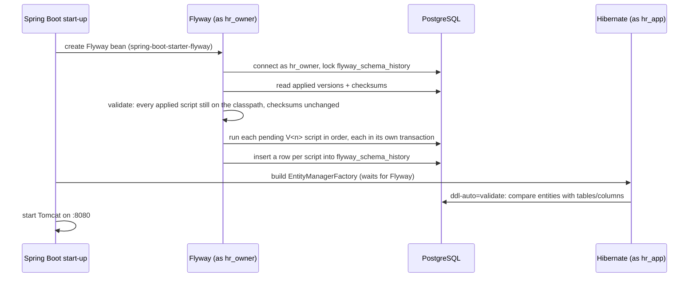
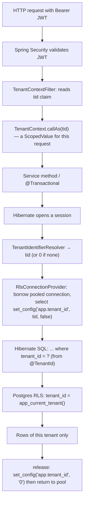
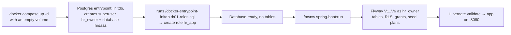

# Database & Flyway workflow

Status: v1 · 2026-10-27 · Flyway 12.4 · PostgreSQL 17 · Spring Boot 4.1 / Hibernate 7

How the schema is created and changed, which database users exist and why, how tenant isolation works from an
HTTP request down to a row, and what to do when something breaks. Design rationale lives in
[ARCHITECTURE.md §4 and §9](ARCHITECTURE.md); this document is the operational side.

---

## 1. The moving parts

| Piece | Where | Job |
|---|---|---|
| PostgreSQL 17 | Docker container (dev), Testcontainers (tests), managed Postgres (prod) | Stores everything; enforces tenant isolation with row-level security (RLS) |
| `01-roles.sql` | `docker/postgres/init/` | Creates the `hr_app` login role, once, when a fresh data volume is initialised |
| Flyway migrations | `src/main/resources/db/migration/V*.sql` | The only way the schema changes; applied in version order at application start-up |
| `flyway_schema_history` | table in the database | Flyway's ledger: which versions ran, when, by whom, and each script's checksum |
| Hibernate `ddl-auto: validate` | `application.yaml` | After Flyway runs, checks that entities match the tables; never changes the schema |
| `RlsConnectionProvider` | `shared/persistence` | Writes `app.tenant_id` on each pooled connection; the RLS policies read it |
| `@TenantId` on `TenantEntity` | `shared/persistence` | Hibernate adds `tenant_id = ?` to queries and fills it on insert |

---

## 2. Two database users, and why

There are two roles, and they are deliberately different:

| Role | Created by | Used by | Owns tables? | Subject to RLS? |
|---|---|---|---|---|
| `hr_owner` | `POSTGRES_USER` of the Postgres image (a **superuser**) | Flyway, you in psql/IntelliJ | Yes, all of them | **No**: superusers have `BYPASSRLS` |
| `hr_app` | `docker/postgres/init/01-roles.sql` | The running application (HikariCP pool) | No | **Yes** |

Configured in `application.yaml`:

```yaml
spring:
  datasource:                      # the application's connections
    url: ${DB_URL:jdbc:postgresql://localhost:5432/hrsaas}
    username: ${DB_APP_USER:hr_app}
    password: ${DB_APP_PASSWORD:hr_app}
  flyway:                          # Flyway opens its own connection with these
    user: ${DB_OWNER_USER:hr_owner}
    password: ${DB_OWNER_PASSWORD:hr_owner}
    placeholders:
      appRole: ${DB_APP_USER:hr_app}   # becomes ${appRole} inside migrations
```

Why split them:

* **Isolation can't be bypassed by an application bug.** RLS policies apply to `hr_app`. A forgotten `where`,
  a native query, or a JPQL mistake still returns only the current tenant's rows.
* **The application can't change the schema.** `hr_app` has `select/insert/update/delete` on tables and `usage` on
  sequences, nothing else. It can't `create`, `alter` or `drop`.
* **Flyway needs DDL rights**, so it runs as the owner.

> `hr_owner` sees every tenant's rows (verified: 25 employees as owner vs 14 for one tenant as `hr_app`).
> When you query as `hr_owner` in IntelliJ you are **not** seeing what the app sees. To reproduce the app's view,
> connect as `hr_app` and set the tenant (see §8.2).

### 2.1 How `hr_app` gets its permissions

`V1__foundation.sql` runs, as `hr_owner`:

```sql
grant usage on schema public to ${appRole};
alter default privileges in schema public grant select, insert, update, delete on tables to ${appRole};
alter default privileges in schema public grant usage on sequences to ${appRole};
```

*Default privileges* mean "every table or sequence that `hr_owner` creates **from now on** is automatically granted
to `hr_app`". You never write `grant` in later migrations. The catch: it only applies to objects created **by
`hr_owner`**. If someone creates a table as a different user, `hr_app` gets `permission denied` on it (§8.5).

Sequences matter because identity columns (`bigint generated by default as identity`) draw from a sequence. Without
`usage`, inserts fail. Sign-up also calls `nextval` on `tenants.id` directly to reserve the new tenant's id before
inserting (`TenantRepository.reserveId()`).

---

## 3. How Flyway works here

### 3.1 When it runs

Flyway is not a separate step you run. Spring Boot runs it **inside application start-up**, before Hibernate:



If any step fails, **the application does not start**. That is intentional: a half-migrated or mismatched
schema never serves traffic.

Spring Boot defaults in effect (none overridden in `application.yaml`):

| Setting | Value | Meaning |
|---|---|---|
| `spring.flyway.locations` | `classpath:db/migration` | Scripts come from `src/main/resources/db/migration` (packaged into the jar) |
| `validate-on-migrate` | `true` | Checksums of applied scripts are verified on every start |
| `clean-disabled` | `true` | `flyway clean` (drop everything) cannot run from the app. Good. |
| `baseline-on-migrate` | `false` | Flyway refuses a non-empty schema that has no history table |
| `out-of-order` | `false` | A new script with a version lower than the latest applied one is an error |
| placeholder syntax | `${name}` | `${appRole}` is replaced; **any other `${...}` in SQL fails** |

### 3.2 The history table

```bash
docker exec hrsaas-postgres psql -U hr_owner -d hrsaas \
  -c "select installed_rank, version, script, checksum, installed_on, success from flyway_schema_history order by 1;"
```

| Column | Use when debugging |
|---|---|
| `version` / `script` | Which migrations this database has |
| `checksum` | CRC32 of the script **as it was when it ran**. Compared with the file on every start |
| `success` | `f` means a script failed half-way (see §8.3) |
| `installed_on` | Tells you if a database is older than a change you made |

### 3.3 Naming and ordering

```
V6__job_titles.sql
│ │  └─ description (underscores become spaces in the history table)
│ └──── two underscores
└────── version: compared numerically (V10 runs after V9)
```

Rules for this project:

* One migration per logical change. Name it after the change, not the date.
* Next version = highest existing + 1. Check `ls src/main/resources/db/migration` **and** what's on `main`
  before picking a number, so two branches don't both create `V7`.
* No repeatable (`R__`) or undo (`U__`) migrations. To reverse something, write a new forward migration.

### 3.4 The golden rule: never edit an applied migration

Once a script has run against **any database you care about**, treat it as read-only. Editing it changes its
checksum, and every database that already ran it will refuse to start:

```
Validate failed: Migrations have failed validation
Migration checksum mismatch for migration version 3
-> Applied to database : -2066435930
-> Resolved locally    : 1234567890
```

Change the schema with a **new** version instead (`alter table ...` in `V7__...`).

**Before the first production database exists**, rewriting V1–Vn is acceptable *if* every developer resets their
local database afterwards (§7.3). Once production exists, never.

> Current state (2026-10-27): the committed `V1`–`V4` still use `uuid` keys, while the working tree (and the
> local database) use `bigint` identity keys. `V5`/`V6` are not committed yet. Commit all six together so a fresh
> clone builds the same schema the entities expect.

### 3.5 What a migration should contain

Every **tenant table** follows the same recipe (copy `V6__job_titles.sql`):

```sql
create table job_titles
(
    id         bigint generated by default as identity primary key,
    tenant_id  bigint       not null references tenants (id),
    code       varchar(30)  not null,
    -- ... columns ...
    created_at timestamptz  not null,
    created_by bigint,
    updated_at timestamptz  not null,
    updated_by bigint,
    version    bigint       not null,       -- optimistic locking (@Version)
    unique (tenant_id, code)                -- tenant_id first in every unique/index
);

alter table job_titles enable row level security;
alter table job_titles force row level security;   -- applies to the owner too (except superusers)
create policy tenant_isolation on job_titles
    using (tenant_id = app_current_tenant())        -- rows you can see/update/delete
    with check (tenant_id = app_current_tenant());  -- rows you can insert/update into
```

Checklist:

- [ ] `tenant_id bigint not null references tenants (id)` (unless it's a platform table, §5)
- [ ] Audit columns + `version` (the entity extends `TenantEntity` → `BaseEntity` → `AuditedEntity`)
- [ ] `tenant_id` first in every composite index and unique constraint
- [ ] `enable` + `force row level security` + `tenant_isolation` policy
- [ ] Child tables without their own `tenant_id` (like `user_roles`, `role_permissions`) get a policy that checks
      the parent through `exists (select 1 from parent ...)`. The parent's own policy filters the subquery.
- [ ] Cross-tenant foreign keys are impossible to express by accident: reference `(tenant_id, id)` when it matters,
      as `V6` does for `employees.job_title_id`.
- [ ] Seed data for **existing** tenants in the same migration if the feature needs it (`V5` seeds default
      roles for every tenant). New tenants get theirs from code at sign-up (`TenantRegistered` listeners).
- [ ] No `grant` statements: default privileges cover new tables.
- [ ] The matching JPA entity/columns, or Hibernate `validate` fails start-up (§8.4).

---

## 4. The tenant path: from JWT to row



Three layers say the same thing, so one bug can't leak data:

1. **`@TenantId`** (Hibernate) adds the predicate and fills `tenant_id` on insert.
2. **RLS** (Postgres) filters again, even for native SQL.
3. **`hr_app` isn't the owner or a superuser**, so RLS can't be skipped.

`app_current_tenant()` (defined in `V1`) reads the setting:

```sql
select nullif(current_setting('app.tenant_id', true), '')::bigint
```

`true` means "return null instead of erroring if unset". With no tenant (or tenant `0`) the policy compares
`tenant_id = null` or `= 0`, which matches nothing. **The safe default is "see nothing".**

### 4.1 Work that has no JWT

These bind the tenant explicitly with `TenantContext.callAs/runAs` **before** opening the transaction:

| Flow | How the tenant is found | Code |
|---|---|---|
| Sign-up | Reserves the next `tenants.id` via `nextval`, binds it, then inserts tenant + owner in one transaction | `AuthService.signUp` |
| Login | Looks up the `tenant` slug in `tenants` (no RLS), then binds it | `AuthService.login` |
| Refresh / logout | Reads the tenant id from the refresh token, then binds it | `AuthService.refresh/logout` |
| Nightly entitlement job | Loops over active tenants, `runAs(tenant.id())` per tenant | `EntitlementJob.syncTenant` |
| `TenantRegistered` listeners | Synchronous `@EventListener`s, same thread and transaction as sign-up, so they inherit the binding | `CalendarService`, `SubscriptionService`, `LeaveSetup` |

If you add an async listener, a scheduled job, or a new unauthenticated endpoint that touches tenant tables, it
**must** bind the tenant this way. Otherwise every query silently returns nothing, and inserts fail the RLS
`with check`.

---

## 5. Table inventory (after V7)

**Platform tables:** shared across tenants, no `tenant_id`, no RLS:

| Table | Since | Notes |
|---|---|---|
| `tenants` | V1 | Companies; `slug` is the "Company ID" users type at login |
| `plans`, `plan_features` | V1 | Catalogue, seeded in V1 (prices are placeholders = 0) |
| `subscriptions` | V1 | One per tenant (`tenant_id unique`), but read via `FeatureGate`, not RLS |
| `event_publication` | V1 | Spring Modulith outbox (created by Flyway, so Modulith's own schema init is disabled) |
| `flyway_schema_history` | — | Flyway's ledger |

**Tenant tables:** RLS enabled + forced, policy `tenant_isolation`:

| Table | Since | Module |
|---|---|---|
| `users`, `refresh_tokens` | V2 | identity |
| `user_roles` | V2, reshaped V5 | identity (policy via `users` and `roles`) |
| `employees` | V3 (+`job_title_id` V6) | employee |
| `work_calendars`, `public_holidays` | V3 | organization |
| `leave_types` (+`workflow_code` V7), `leave_settings`, `leave_requests`, `leave_transactions` | V4 | leave |
| `roles`, `role_permissions` | V5 | identity (`role_permissions` via `roles`) |
| `job_titles` | V6 | employee |
| `approval_workflows`, `approval_workflow_steps` | V7 | workflow (steps via `approval_workflows`) |
| `approval_instances`, `approval_steps`, `approval_actions` | V7 | workflow; `approval_actions` is insert-only for `hr_app` (UPDATE/DELETE revoked) |
| `request_types`, `employee_requests` | V7 | request (`fields` / `data` are `jsonb`) |

Since V7 some default **data** is seeded by the application rather than by migrations: workflows and request types
are created at sign-up and, for companies that existed before V7, at start-up (`WorkflowSetup`, `RequestSetup`);
pending leave requests filed before V7 get their approval at start-up (`LeaveSetup`). All three are idempotent.
See [WORKFLOWS.md](WORKFLOWS.md).

List them live:

```sql
select c.relname, pg_get_userbyid(c.relowner) owner, c.relrowsecurity rls, c.relforcerowsecurity forced
from pg_class c join pg_namespace n on n.oid = c.relnamespace
where n.nspname = 'public' and c.relkind = 'r' order by rls desc, 1;
```

---

## 6. Where Postgres runs: dev, tests, prod

| Context | Started by | Image | Data | Who runs migrations |
|---|---|---|---|---|
| **Local dev** | You (`docker compose up -d`) on Colima | `postgres:17-alpine` | Named volume, survives restarts | The app at start-up |
| **`./mvnw test`** | Testcontainers, one container per test JVM | `postgres:17-alpine` | Throw-away, deleted after the run | The app context in the test |
| **`TestHrSaasApplication`** | Testcontainers (run the app with a fresh DB) | `postgres:17-alpine` | Throw-away | The app at start-up |
| **Production** | Managed Postgres (planned) | n/a | Managed, PITR backups | The app at start-up (or a dedicated migration job, §7.5) |

### 6.1 Local dev container (`compose.yaml`)

`compose.yaml` is the single definition of the dev database. It pins the names, so `docker compose` and plain
`docker` commands point at the same container and data:

| | Value | Why |
|---|---|---|
| Container | `hrsaas-postgres` (`container_name`) | Stable name for `docker exec` / `docker logs`, used throughout these docs |
| Volume | `hrsaas-postgres-data` (`volumes.postgres-data.name`) | Holds all data; survives `docker compose down` and container recreation |
| Restart | `unless-stopped` | Comes back by itself whenever Colima starts |
| Init scripts | bind-mounted `docker/postgres/init` | `01-roles.sql` creates `hr_app` on a brand-new volume only |
| Port | `5432:5432` | What `DB_URL` defaults to |

```bash
docker compose up -d        # create/start (idempotent; recreates the container if compose.yaml changed)
docker compose ps
docker compose stop         # stop, keep container and data
docker compose down         # remove container + network, KEEP the volume (data stays)
docker compose down -v      # remove the volume too: wipes the database (§7.3)
```

Compose is installed with Homebrew (`brew install docker-compose`). Until the plugin is registered in
`~/.docker/config.json` (`"cliPluginsExtraDirs": ["$HOME/.homebrew/lib/docker/cli-plugins"]`, with the path
spelled out), use the standalone form `docker-compose …`; the commands are identical.

Things to know:

* **Warning on every `up`:** `volume "hrsaas-postgres-data" already exists but was not created by Docker
  Compose`. Harmless: the volume was originally made by `docker run` (2026-10-21) and has no compose labels.
  Compose still uses it. It disappears after a full reset (`down -v` + `up -d`), when compose creates it itself.
* **History:** until 2026-10-27 the container was started with `docker run` and `compose.yaml` used default names
  (`human-resources-postgres-1`, `human-resources_postgres-data`), i.e. a *different, empty* database. The file now
  pins the names; the old container was removed and recreated by compose on the same volume (no data change).
* Changing `image`, `environment` or the ports in `compose.yaml` takes effect on the next `docker compose up -d`
  (the container is recreated, the volume is reused). `POSTGRES_*` variables only matter on a brand-new volume.

### 6.2 What happens on a brand-new volume



**Init scripts run only when the data directory is empty.** Editing `01-roles.sql` does nothing to an existing
volume. You either apply the change by hand or recreate the volume (§7.3).

### 6.3 Tests (Testcontainers)

`TestcontainersConfiguration` mirrors production:

* starts `postgres:17-alpine` and copies `docker/postgres/init/01-roles.sql` into its init directory, so `hr_app`
  exists;
* points Flyway at the container's superuser and the application at `hr_app`/`hr_app`;
* `@IntegrationTest` shares one Spring context (so one container) across all integration tests in a run.

So every `./mvnw test` builds the schema from **zero** with your current migrations. A migration that fails
on an empty database fails the build, even if your long-lived dev database is fine. `TenantIsolationIntegrationTest`
checks that one tenant can't see another's data with RLS on.

On this machine Testcontainers needs the Colima socket:

```bash
DOCKER_HOST=unix://$HOME/.colima/default/docker.sock \
TESTCONTAINERS_DOCKER_SOCKET_OVERRIDE=/var/run/docker.sock \
TESTCONTAINERS_RYUK_DISABLED=true ./mvnw test
```

With Ryuk disabled, a test JVM that is killed (not finished) can leave a container behind. Clean up with
`docker ps -a --filter ancestor=postgres:17-alpine`, but **don't** remove `hrsaas-postgres`.

---

## 7. Everyday workflows

### 7.1 Add a table or column

1. Create `src/main/resources/db/migration/V7__<what>.sql` (checklist §3.5).
2. Add or adjust the entity (`extends TenantEntity` for tenant tables).
3. `./mvnw test`: proves the migration works from scratch and the entity matches.
4. Start the app against your dev DB: Flyway applies `V7`, Hibernate validates.
5. Commit the migration and the entity together.

### 7.2 Change existing data

Data fixes also go in a migration, so every environment gets them:

```sql
-- V8__backfill_job_titles.sql
update employees set job_title_id = ... where ...;
```

Migrations run as `hr_owner` (superuser in dev), so RLS **does not** filter them. Write `where tenant_id = ...`
deliberately, or loop over tenants as `V5` does.

### 7.3 Reset your local database

You need this after rewriting an already-applied migration (pre-production only), or to start clean.

```bash
# Option A — keep the container, wipe the schema (fast)
docker exec hrsaas-postgres psql -U hr_owner -d hrsaas \
  -c "drop schema public cascade; create schema public;"
#   hr_app still exists (roles are cluster-wide); start the app → Flyway re-runs V1..Vn
#   then optionally refill demo data:  (frontend repo) pnpm seed:demo

# Option B — recreate the volume (also re-runs 01-roles.sql)
docker compose down -v && docker compose up -d
```

Both destroy all local data.

### 7.4 See which migrations are pending without starting the app

Compare the files with the history table:

```bash
ls src/main/resources/db/migration
docker exec hrsaas-postgres psql -U hr_owner -d hrsaas -Atc "select script from flyway_schema_history order by installed_rank;"
```

### 7.5 Production notes (when you get there)

* The owner/migration role on managed Postgres is usually **not** a superuser. Then `force row level security`
  *does* apply to it, so data-fix migrations on tenant tables must set `app.tenant_id` or use a role with
  `BYPASSRLS`. Test this before the first prod migration.
* Consider running migrations as a separate step (`flyway migrate` in CI/CD, or a one-off container) and
  setting `spring.flyway.enabled=false` on app instances. With several instances starting at once, Flyway's lock
  makes them wait, but a separate step gives you a clear go/no-go before traffic shifts.
* Take a backup before migrating. Flyway has no automatic rollback; you fix forward with a new version.
* Write migrations so the **previous** app version still works after they run (add columns as nullable, backfill,
  then tighten in a later version). Rolling deploys run old and new code against the same schema.

---

## 8. Debugging playbook

### 8.1 "The app won't start" — read the first `Caused by`

| Message contains | Cause | Fix |
|---|---|---|
| `Migration checksum mismatch for migration version N` | An applied script was edited | Revert the edit and put the change in a new version. Pre-prod only: reset the DB (§7.3) |
| `Detected applied migration not resolved locally: N` | DB ran a version whose file is gone (you switched branch, or deleted it) | Restore the file, or (pre-prod) reset the DB |
| `Detected resolved migration not applied to database: N` with `outOfOrder` | You added a version lower than one already applied (branch merge) | Renumber yours above the latest |
| `Found non-empty schema(s) "public" but no schema history table` | Tables were created outside Flyway | Reset the DB; never create tables by hand |
| `No value provided for placeholder: ${x}` | `${...}` in SQL that isn't `appRole` | Escape it or avoid that syntax |
| `Schema-validation: missing table [x]` / `missing column [y]` | Entity changed, migration missing (or not applied) | Write the migration (§7.1) |
| `Schema-validation: wrong column type ... found [uuid], but expecting [bigint]` | DB built from old scripts (e.g. the committed uuid V1–V4) | Reset the DB with the current scripts |
| `Connection to localhost:5432 refused` | Postgres not running | `colima start`, then `docker compose up -d` |
| `password authentication failed for user "hr_app"` | Volume initialised without `01-roles.sql` | `create role hr_app login password 'hr_app';` as `hr_owner`, or recreate the volume |

### 8.2 "Query returns nothing" or "I can see it in IntelliJ but the API returns 404"

You're probably querying as `hr_owner` (sees everything) while the app is `hr_app` (sees one tenant). Reproduce
the app's view:

```bash
docker exec -it -e PGPASSWORD=hr_app hrsaas-postgres psql -h localhost -U hr_app -d hrsaas
```

```sql
select current_setting('app.tenant_id', true);            -- empty → you see nothing
select set_config('app.tenant_id', '4', false);           -- 4 = tenants.id (look up by slug as hr_owner)
select id, code, full_name_en from employees;             -- now exactly what the API sees for tenant 4
```

If the app returns nothing for an authenticated request, check that the code path binds a tenant (§4.1): a new
`@Scheduled` job or `@Async` listener without `TenantContext.runAs` is the usual culprit.

### 8.3 "A migration failed half-way"

PostgreSQL runs each migration in a transaction, so a failing script rolls back completely, including DDL, and
the history row is not committed. Fix the script (it never applied, so editing is fine) and restart.

The exception is statements that can't run in a transaction (e.g. `create index concurrently`). Flyway then records
`success = f`. Repair by hand: undo whatever did apply, delete that history row as `hr_owner`, fix, restart.

### 8.4 "new row violates row-level security policy"

An insert/update hit the policy's `with check`: the row's `tenant_id` doesn't match `app.tenant_id`. Usually no
tenant is bound (setting is `0`), so the flow needs `TenantContext.callAs`. Or code tried to write another
tenant's id; `@TenantId` fills it automatically, so don't set it by hand.

### 8.5 "permission denied for table X" as `hr_app`

The table was created by a role other than `hr_owner`, so default privileges didn't apply. Check
`select tableowner from pg_tables where tablename = 'x';`. Always create schema objects through Flyway.

### 8.6 Useful one-liners

```bash
# psql as owner (sees all tenants)
docker exec -it hrsaas-postgres psql -U hr_owner -d hrsaas

# tenants and their ids
docker exec hrsaas-postgres psql -U hr_owner -d hrsaas -c "select id, slug, name, status from tenants;"

# policies on a table
docker exec hrsaas-postgres psql -U hr_owner -d hrsaas -c "\d+ employees"

# who is connected (app pool shows up as hr_app)
docker exec hrsaas-postgres psql -U hr_owner -d hrsaas -c "select usename, state, query from pg_stat_activity where datname='hrsaas';"

# SQL the app sends (add to application.yaml temporarily)
#   logging.level.org.hibernate.SQL: debug
#   logging.level.org.flywaydb: debug
```
