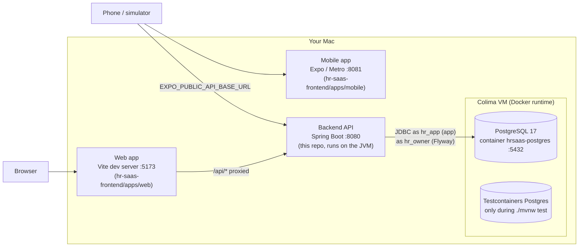

# Services, runtime & local development

Status: v1 · 2026-10-27

What runs where, when Docker is involved and why, how the pieces talk to each other, and the commands you use
day to day. For the database, migrations and tenant isolation in depth, see [DATABASE.md](DATABASE.md). For design
decisions, see [ARCHITECTURE.md](ARCHITECTURE.md).

---

## 1. System map (local development)



| Process | Port | Runs in Docker? | Started with |
|---|---|---|---|
| PostgreSQL | 5432 | **Yes** | `docker compose up -d` (then auto-starts with Colima) |
| Backend API | 8080 | No (JVM on the Mac / IntelliJ) | `./mvnw spring-boot:run` or IntelliJ Run |
| Web app | 5173 | No (Node) | `pnpm dev:web` in `hr-saas-frontend` |
| Mobile bundler | 8081 | No (Node) | `pnpm dev:mobile` in `hr-saas-frontend` |
| Test database | random | **Yes** (temporary) | Testcontainers, automatically during tests |

---

## 2. When Docker is used, and why

Docker is used **only for things that are painful to install natively and must match production exactly**,
which today means PostgreSQL. Your own code runs natively, so you get fast restarts, IntelliJ breakpoints and hot
reload.

| Use | Why Docker | Lifetime |
|---|---|---|
| **Dev database** (`postgres:17-alpine`) | Same major version as prod, no local Postgres install, init script creates `hr_app`, easy to wipe and recreate | Long-lived; data in volume `hrsaas-postgres-data` |
| **Integration tests** (Testcontainers) | Every test run gets a **fresh** database built by the real migrations, with RLS active, independent of your dev data | One run; removed afterwards |
| **`TestHrSaasApplication`** | Run the full app against a throw-away database, e.g. to try a migration without touching dev data | Until you stop the app |
| **Deployment image** *(future)* | `./mvnw spring-boot:build-image` builds an OCI image with Cloud Native Buildpacks, no Dockerfile to maintain | Per release |

Not in Docker, on purpose:

* **The backend in dev.** Running it in a container would slow every change down and complicate debugging. The
  image matters only for deployment.
* **The frontends.** Node tooling (Vite HMR, Metro) works best natively.

### 2.1 Colima

Colima is the Docker runtime on this Mac (a small Linux VM). Docker commands talk to it through its socket.

```bash
colima start          # needed after a reboot before any docker command
colima status
colima stop           # stops the VM, and with it every container
```

`hrsaas-postgres` has `restart: unless-stopped` in `compose.yaml`, so it comes back by itself whenever Colima starts.

### 2.2 The dev database container

Defined in `compose.yaml` (container `hrsaas-postgres`, volume `hrsaas-postgres-data`); details in
[DATABASE.md §6.1](DATABASE.md#61-local-dev-container-composeyaml). Compose manages its lifecycle; plain `docker`
commands work on it too because the container name is fixed. (`docker compose` needs the Homebrew plugin
registered; otherwise run `docker-compose` with the same arguments.)

```bash
docker compose up -d                        # create/start
docker compose ps                           # is it running?
docker logs -f hrsaas-postgres              # Postgres server log
docker stop hrsaas-postgres                 # stop (data kept)
docker start hrsaas-postgres                # start again
docker exec -it hrsaas-postgres psql -U hr_owner -d hrsaas
```

---

## 3. Backend services (modules)

One deployable (Spring Modulith). Each module owns its tables and exposes a public API package; `internal`
packages are private. Boundaries are verified by `ModularityTests`.

| Module | REST endpoints (`/api/v1/...`) | Tables | Notes |
|---|---|---|---|
| **platform** | — | `tenants` | Tenant registry; `TenantDirectory` used by identity and jobs |
| **identity** | `auth/signup`, `auth/login`, `auth/refresh`, `auth/logout`, `me`, `users`, `roles`, `roles/permissions` | `users`, `user_roles`, `refresh_tokens`, `roles`, `role_permissions` | JWT (HS256) with `sub` = user id and `tid` = tenant id; refresh tokens rotate and are stored hashed |
| **billing** | `billing/plans` (public), `billing/subscription` | `plans`, `plan_features`, `subscriptions` | `@RequiresFeature` + `FeatureGateInterceptor` gate modules by plan; 14-day PRO trial at sign-up |
| **organization** | `organization/calendar`, `organization/holidays` | `work_calendars`, `public_holidays` | Rest days + holidays drive leave day counting |
| **employee** | `employees`, `employees/{id}/terminate` | `employees`, `job_titles` | Publishes `EmployeeHired` / `EmployeeTerminated` (no listeners yet) |
| **leave** | `leave/types`, `leave/settings`, `leave/requests` (+ approve/reject/cancel), `leave/adjustments`, `leave/employees/{id}/balances` / `transactions`, `me/leave/*` | `leave_types`, `leave_settings`, `leave_requests`, `leave_transactions` | Balance = ledger sum; Egyptian leave types seeded per tenant; nightly entitlement job; approval via the leave type's workflow |
| **workflow** | `workflows` (+ `/{code}/default`), `approvals/inbox`, `approvals`, `approvals/{id}` (+ approve/reject, `steps/{stepId}/reassign`) | `approval_workflows`, `approval_workflow_steps`, `approval_instances`, `approval_steps`, `approval_actions` | Engine behind every approval; publishes `ApprovalCompleted`. See [WORKFLOWS.md](WORKFLOWS.md) |
| **request** | `request-types`, `requests` (+ cancel), `me/requests` | `request_types`, `employee_requests` | Configurable request types (forms as JSON); publishes `RequestApproved` / `RequestCancelled` (no listeners yet) |
| **shared** | — | `event_publication` | Tenant context, persistence base classes, RLS connection provider, errors (`ProblemDetail`) |

Explore the API interactively at **http://localhost:8080/swagger-ui.html** (spec: `/v3/api-docs`, which also
generates the frontend's typed client).

### 3.1 Life of a request

```mermaid
sequenceDiagram
    participant C as Client (web/mobile)
    participant S as Spring Security
    participant F as TenantContextFilter
    participant G as FeatureGateInterceptor
    participant Ctl as Controller (@PreAuthorize)
    participant Svc as Service (@Transactional)
    participant DB as Postgres (RLS)
    C->>S: GET /api/v1/employees  Authorization: Bearer <jwt>
    S->>S: verify signature, expiry, issuer; map roles → permissions
    S->>F: authenticated
    F->>F: TenantContext.callAs(jwt.tid) + MDC tenantId
    F->>G: continue
    G->>G: tenant's plan includes CORE_HR? else 402
    G->>Ctl: continue
    Ctl->>Ctl: hasAuthority('employee:read')? else 403
    Ctl->>Svc: list(...)
    Svc->>DB: set_config('app.tenant_id', tid) → select ... where tenant_id = ?
    DB-->>Svc: this tenant's rows only
    Svc-->>C: 200 JSON  (errors: application/problem+json)
```

### 3.2 Events and background work

| Trigger | Listener / job | Effect |
|---|---|---|
| `TenantRegistered` (sign-up) | `CalendarService`, `SubscriptionService`, `LeaveSetup`, `WorkflowSetup`, `RequestSetup` | Default work calendar, PRO trial, Egyptian leave types + settings, default workflows and request types. Synchronous, inside the sign-up transaction |
| `ApplicationReadyEvent` (start-up) | `WorkflowSetup` (first), `RequestSetup`, `LeaveSetup` | Seed defaults for companies that have none; start approvals for pending leave filed before V7. Idempotent |
| `ApprovalCompleted` | `LeaveRequestService`, `EmployeeRequestService` | Applies the final outcome to the leave / employee request (balance usage on approval). Synchronous: a failure rolls the decision back |
| `EmployeeHired` / `EmployeeTerminated` | *none yet* | Published by `EmployeeService` for future consumers (attendance, payroll). Leave entitlements don't depend on them: they sync on demand when balances are read or requested, and nightly |
| `0 30 0 * * *` Africa/Cairo | `EntitlementJob` | Brings annual leave entitlements up to date for every active tenant |

Scheduling is on by default; tests turn it off with `hrsaas.scheduling.enabled=false`. Modulith's event
publication registry (`event_publication`) records events for listeners, so failed deliveries can be inspected
there.

---

## 4. Configuration

All values have dev defaults in `src/main/resources/application.yaml`; override them with environment variables.

| Variable | Default (dev) | Used for |
|---|---|---|
| `DB_URL` | `jdbc:postgresql://localhost:5432/hrsaas` | Database for both the app and Flyway |
| `DB_APP_USER` / `DB_APP_PASSWORD` | `hr_app` / `hr_app` | Application connection pool (subject to RLS); also the `${appRole}` placeholder |
| `DB_OWNER_USER` / `DB_OWNER_PASSWORD` | `hr_owner` / `hr_owner` | Flyway migrations (owns the schema) |
| `JWT_SECRET` | dev-only string | HS256 signing key, **≥ 32 bytes, must be set in every deployed environment** |

Other settings in `application.yaml`: access token 15 min, refresh token 30 days, trial plan `PRO` for 14 days,
virtual threads on, `open-in-view: false`, `ddl-auto: validate`, Actuator exposes `health`, `info`, `modulith`.

### 4.1 Maven on this machine

The project carries its own Maven settings so it never touches your employer's infrastructure:

* `.mvn/maven.config` → `-s .mvn/settings.xml -Djavax.net.ssl.trustStoreType=PKCS12`
* `.mvn/settings.xml` → no mirrors, local repository `~/.m2/repository-personal`

Always use the wrapper (`./mvnw`), which picks these up. IntelliJ's Maven runner should point at the same settings
file.

---

## 5. Daily routine

```bash
# 1. Docker runtime (after a reboot)
colima start                                  # hrsaas-postgres starts with it (first time: docker compose up -d)

# 2. Backend (this repo) — Flyway migrates on start-up
./mvnw spring-boot:run                        # or IntelliJ ▶ HrSaasApplication
curl -s localhost:8080/actuator/health        # {"status":"UP"}

# 3. Frontend (hr-saas-frontend)
pnpm dev:web                                  # http://localhost:5173
pnpm api:generate                             # after backend API changes (backend must be running)
pnpm seed:demo                                # optional demo company "nile-foods"

# Stop
# Ctrl+C the backend and the dev servers; Postgres can keep running (or: docker stop hrsaas-postgres)
```

### 5.1 Tests

```bash
DOCKER_HOST=unix://$HOME/.colima/default/docker.sock \
TESTCONTAINERS_DOCKER_SOCKET_OVERRIDE=/var/run/docker.sock \
TESTCONTAINERS_RYUK_DISABLED=true ./mvnw test
```

| Test | Proves |
|---|---|
| `ModularityTests` | Module boundaries (no reaching into another module's `internal`) |
| `TenantIsolationIntegrationTest` | One tenant can't read or change another's data, with RLS on |
| `AuthFlowIntegrationTest`, `RoleIntegrationTest` | Sign-up, login, refresh rotation and reuse detection, roles |
| `FeatureGateIntegrationTest` | Plan features gate endpoints |
| `LeaveIntegrationTest`, `LeaveDaysTest`, `AnnualEntitlementTest` | Leave rules and Egyptian entitlements |

### 5.2 Run against a throw-away database

Run `TestHrSaasApplication` (in `src/test/java`) from IntelliJ, or `./mvnw spring-boot:test-run` with the
Testcontainers environment variables above. Testcontainers starts a fresh Postgres, Flyway builds the schema, and
your dev data is untouched. Handy for checking a new migration before it hits your dev database.

---

## 6. Observability & troubleshooting

| Want to know | Look at |
|---|---|
| Is the app up? | `GET /actuator/health` |
| Which modules and events exist? | `GET /actuator/modulith` |
| Which tenant a log line belongs to | Log MDC key `tenantId` (set by `TenantContextFilter`) |
| SQL being sent | `logging.level.org.hibernate.SQL: debug` |
| What Flyway did | `flyway_schema_history` table, or `logging.level.org.flywaydb: debug` |
| Why a request got 401/402/403 | 401 = token missing, expired or invalid; 402 = the tenant's plan lacks the feature (`FeatureGateInterceptor`, code `billing.feature-not-in-plan`); 403 = the user lacks the permission (`@PreAuthorize`) |

| Symptom | Likely cause | Fix |
|---|---|---|
| `Cannot connect to the Docker daemon` | Colima stopped | `colima start` |
| Backend: `Connection refused` to 5432 | Postgres container stopped | `docker compose up -d` |
| Backend: `Port 8080 already in use` | A previous run is still alive | `lsof -nP -iTCP:8080 -sTCP:LISTEN`, then stop that process |
| Backend won't start after a pull | New/changed migration or entity | See [DATABASE.md §8.1](DATABASE.md#81-the-app-wont-start--read-the-first-caused-by) |
| Tests: `Could not find a valid Docker environment` | Testcontainers can't find Colima's socket | Use the environment variables in §5.1 |
| Web app shows "Bad Gateway" on login | Backend not running (Vite proxy target is down) | Start the backend |
| Data visible in IntelliJ but not via the API | IntelliJ connects as `hr_owner` (bypasses RLS) | See [DATABASE.md §8.2](DATABASE.md#82-query-returns-nothing-or-i-can-see-it-in-intellij-but-the-api-returns-404) |
