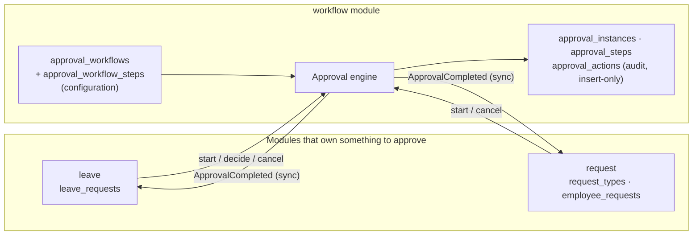

# Approval workflows and employee requests

How requests are approved: leave, and every other request type (permissions, work from home, missions, loans,
salary advances, overtime reviews, training, certifications, resignations, terminations, and any type a company
adds). Added in V7. Related: [ARCHITECTURE.md](ARCHITECTURE.md), [DATABASE.md](DATABASE.md).

---

## 1. The pieces



* **Workflow** (`approval_workflows`): a named approval chain, e.g. `MANAGER_HR`. Tenant data, edited without code.
* **Request type** (`request_types`): what can be requested, its form, who may file it, a monthly limit, and the
  workflow that decides it. Leave types also name a workflow (`leave_types.workflow_code`).
* **Approval** (`approval_instances`): one per filed request. Its steps are **copied** from the workflow at
  submission, so editing a workflow never changes requests already in flight.
* **Audit trail** (`approval_actions`): every submission, assignment, escalation, skip, decision, override,
  reassignment and cancellation, with who, when and the note. The application's database role cannot update or
  delete these rows (V7 revokes it).

The owning module (leave, request) checks its own business rules (balances, form fields, limits). The engine decides
**who** may approve **when**, and tells the owner the final outcome through `ApprovalCompleted`, published
synchronously in the same transaction: if applying the outcome fails (e.g. the leave balance ran out meanwhile), the
decision is rolled back and the approver gets the error.

---

## 2. The rules

### 2.1 Who can be an approver

Each step names its approver with one of these rules. **Job titles are not used**: in this system a title describes
the work, not authority. Reporting lines and roles are what grant approval rights.

| `approverType` | Approver | Notes |
|---|---|---|
| `DIRECT_MANAGER` | The employee's manager (`employees.manager_id`) | Must be an active employee with an active user account |
| `MANAGER_LEVEL` + `managerLevel` *n* ≥ 2 | The manager *n* levels up (2 = manager's manager) | Walks `manager_id` upwards; cycles are ignored |
| `ROLE` + `roleCode` | Any active user holding the role (e.g. `HR_ADMIN`, `PAYROLL_ADMIN`, a custom `FINANCE` role) | The first of them to decide completes the step |
| `USER` + `userId` | One named user | e.g. the CEO |

Always true, for every step:

* **Nobody decides their own request**: not even HR or the owner. The employee is never assigned and is excluded
  when looking for role holders.
* Only the **current stage** can be decided. A later approver cannot jump ahead.
* Roles are read from the database at decision time, not from the JWT, so a role removed a minute ago no longer
  counts.

### 2.2 Order: stages, sequential and parallel

Each step has a `stage` number. **Stages run in ascending order; steps with the same stage run in parallel and all of
them must approve.** Stage numbers don't need to be consecutive. The API shows them as "step 2 of 3"
(`currentStageNumber` / `stageCount`).

```
stage 1: Direct manager ──▶ stage 2: Second-level manager ──▶ stage 3: HR  ┐ both must
                                                                stage 3: Payroll ┘ approve
```

### 2.3 Conditions

A step may have one condition on a number from the request: `conditionField` `conditionOperator`
(`GT`, `GTE`, `LT`, `LTE`, `EQ`) `conditionValue`. For leave the number is `days`; for request types it is any
`NUMBER` / `AMOUNT` field (`amount`, `hours`, `cost`, ...). A step whose condition is false, or whose field is empty,
is left out of the approval at submission. Example: the `FINANCE` workflow adds the second-level manager only when
`amount GT 20000`.

### 2.4 When the approver is missing or unavailable

"Missing" means: no manager at that level, the manager has left or has no active account, nobody else holds the
role, or the named user is disabled. Each step says what to do (`ifUnresolved`):

| Policy | What happens | Audit entry |
|---|---|---|
| `SKIP` | The step is skipped; the approval moves on | `SKIPPED` + reason |
| `ESCALATE` | Manager steps go **further up the reporting line** to the next usable manager; when it runs out (and for role/user steps) → the fallback role | `ESCALATED` + reason |
| `FALLBACK` | Straight to the fallback role (`fallbackRoleCode`, default `OWNER`) | `ESCALATED` + reason |

If the fallback role has nobody else either, the step goes to `OWNER` (that role always exists). Escalated and
fallback steps are never skipped.

**Safety net:** if every step ends up skipped or left out by its condition, a final `OWNER` step is added. **A request
is never approved by nobody.**

**Unavailable (on leave, sick, left the company):**

* Holders of `workflow:manage` (HR administrators, owners) can **reassign** a pending step to another active user,
  with a mandatory note: `POST /api/v1/approvals/{id}/steps/{stepId}/reassign`.
* They can also **override**: approving or rejecting the current stage they are not assigned to. This decides all
  pending steps of the current stage only (the next stage still needs its own approver) and is recorded as
  `OVERRIDE_APPROVED` / `OVERRIDE_REJECTED`. The own-request rule still applies.
* Out-of-office delegation is not built yet (§7).

### 2.5 When is a request approved or rejected

| Event | Result |
|---|---|
| Every stage has all its steps approved or skipped (and at least one real approval happened) | **Approved**. The owner applies it (leave: balance usage, `LeaveApproved`; requests: `RequestApproved`) |
| Any approver rejects | **Rejected immediately**. Remaining steps → `CANCELLED`. A **reason is required** (`approval.reason-required`): the employee sees it |
| Employee withdraws (pending only) or HR cancels (pending or approved) | **Cancelled**. Open steps → `CANCELLED`; approved leave days go back to the balance |

### 2.6 What the employee sees

Status is one of `PENDING`, `APPROVED`, `REJECTED` or `CANCELLED` on the request itself. The detail view of a leave or
employee request carries an `approval` object with:
* the steps (name, who it is with, status, who decided, when, note);
* "step *n* of *m*";
* the full history.

The rejection reason is also copied to `decisionNote`.

---

## 3. Defaults every company starts with

Seeded at sign-up, and on start-up for companies created before V7. The workflow defaults are in
`DefaultWorkflows` and the request types in `DefaultRequestTypes`.

### 3.1 Workflows

| Code | Steps | Used by |
|---|---|---|
| `MANAGER` (**default**) | 1 Direct manager (escalate, fallback HR) | Annual & casual leave, permissions, work from home, and anything that names no workflow |
| `MANAGER_HR` | 1 Direct manager (escalate) → 2 HR (fallback owner) | Sick, maternity, Hajj and unpaid leave; missions; training; certifications |
| `MANAGERS_HR` | 1 Direct manager (escalate) → 2 Second-level manager (skip if none) → 3 HR | Resignation |
| `FINANCE` | 1 Direct manager (escalate) → 2 Second-level manager **if amount > 20,000** (skip if none) → 3 HR ∥ Payroll | Loan, salary advance, overtime payment review |
| `HR_OWNER` | 1 HR → 2 Company owner | Termination |

### 3.2 Request types

| Code | Category | Form fields (`*` = required) | Workflow | Self-service | Managers may file for their reports | Limit |
|---|---|---|---|---|---|---|
| `EARLY_DEPARTURE` | PERMISSION | date*, time* | MANAGER | ✓ | ✓ | 2 / month |
| `LATE_ARRIVAL` | PERMISSION | date*, time* | MANAGER | ✓ | ✓ | 2 / month |
| `TEMPORARY_EXIT` | PERMISSION | date*, fromTime*, toTime* | MANAGER | ✓ | ✓ | 2 / month |
| `WORK_FROM_HOME` | REMOTE_WORK | startDate*, endDate* | MANAGER | ✓ | ✓ | |
| `MISSION` | TRAVEL | destination*, startDate*, endDate*, cost | MANAGER_HR | ✓ | ✓ | |
| `LOAN` | FINANCIAL | amount* (≥ 1), installments* (1-60) | FINANCE | ✓ | | |
| `SALARY_ADVANCE` | FINANCIAL | amount* | FINANCE | ✓ | | 1 / month |
| `OVERTIME_REVIEW` | FINANCIAL | date*, hours* (0.5-24) | FINANCE | ✓ | ✓ | |
| `TRAINING_COURSE` | DEVELOPMENT | course*, provider, startDate*, endDate, cost | MANAGER_HR | ✓ | ✓ | |
| `CERTIFICATION` | DEVELOPMENT | certification*, provider, examDate, cost | MANAGER_HR | ✓ | ✓ | |
| `RESIGNATION` | LIFECYCLE | lastWorkingDay* | MANAGERS_HR | ✓ | | |
| `TERMINATION` | LIFECYCLE | lastWorkingDay*, grounds* (list) | HR_OWNER | **✗** | ✓ | |

HR (`request:manage`) may file any type for anyone. "Managers may file" means any manager **above** the employee in
the reporting line, not just the direct one. Monthly limits count pending + approved requests filed in the current
calendar month (company time zone).

---

## 4. Configuring it (no code changes)

**Field types** for request forms: `TEXT` (≤ 200 characters), `LONG_TEXT` (≤ 2,000), `NUMBER`, `AMOUNT` (≤ 2
decimals), `DATE` (`yyyy-MM-dd`), `TIME` (`HH:mm`), `BOOLEAN`, `SELECT` (`options`). `NUMBER` and `AMOUNT` take
optional `min` and `max`. Submitted data is checked against the form: required fields, types, ranges, list options,
and no unknown keys.

Add a request type that uses a new workflow:

```http
POST /api/v1/workflows                      (workflow:manage, plan with APPROVAL_WORKFLOWS)
{"code": "FINANCE_DIRECTOR", "nameEn": "Finance director", "nameAr": "المدير المالي", "active": true,
 "steps": [
   {"stage": 1, "nameEn": "Direct manager", "nameAr": "المدير المباشر", "approverType": "DIRECT_MANAGER",
    "ifUnresolved": "ESCALATE", "fallbackRoleCode": "HR_ADMIN"},
   {"stage": 2, "nameEn": "Finance", "nameAr": "المالية", "approverType": "ROLE", "roleCode": "FINANCE",
    "ifUnresolved": "FALLBACK", "fallbackRoleCode": "OWNER",
    "conditionField": "amount", "conditionOperator": "GTE", "conditionValue": 5000}]}

POST /api/v1/request-types                  (request:manage)
{"code": "EQUIPMENT", "nameEn": "Equipment purchase", "nameAr": "شراء معدات", "category": "OTHER",
 "workflowCode": "FINANCE_DIRECTOR", "selfService": true, "allowOnBehalf": true, "maxPerMonth": null,
 "active": true, "sortOrder": 130,
 "fields": [{"key": "item", "labelEn": "Item", "labelAr": "الصنف", "type": "TEXT", "required": true},
            {"key": "amount", "labelEn": "Amount (EGP)", "labelAr": "المبلغ", "type": "AMOUNT", "required": true,
             "min": 1}]}
```

* Point a leave type at a workflow: `PUT /api/v1/leave/types/{code}` with `"workflowCode": "MANAGER_HR"`. Leaving
  the field out (or `null`) keeps the current workflow; `""` resets it to the company default.
* Change which workflow is the default: `POST /api/v1/workflows/{code}/default`.
* Workflows and types are **deactivated, never deleted** (`active: false`), because others refer to them by code. A
  request whose type names an inactive or unknown workflow uses the default; the history notes it.
* Every plan runs the default workflows. Creating or editing workflows needs the `APPROVAL_WORKFLOWS` feature
  (Pro and Enterprise), otherwise `402`.

---

## 5. API

| Who | Endpoint | Purpose |
|---|---|---|
| Employee | `GET /api/v1/request-types` | Active types and their forms (show the ones with `selfService`) |
| Employee | `POST /api/v1/me/requests` `{type, data, reason}` · `GET /api/v1/me/requests` | File / list own requests |
| Employee, filer, approvers, HR | `GET /api/v1/requests/{id}` | Request + approval timeline (others get 404) |
| Employee (pending), HR | `POST /api/v1/requests/{id}/cancel` | Withdraw / cancel |
| Manager, HR | `POST /api/v1/requests` `{employeeId, type, data, reason}` | File for someone |
| HR | `GET /api/v1/requests?status=&type=&employeeId=` | All requests |
| Anyone | `GET /api/v1/approvals/inbox` | What I can decide now: leave and requests together, oldest first |
| Approvers | `GET /api/v1/approvals/{id}` · `POST .../approve` `{note}` · `POST .../reject` `{note}` (required) | Decide |
| Workflow admins | `GET /api/v1/approvals?status=` · `POST /api/v1/approvals/{id}/steps/{stepId}/reassign` | Monitor, reassign |
| HR | `GET/POST/PUT /api/v1/workflows`, `GET/POST/PUT /api/v1/request-types` | Configure |

`POST /api/v1/leave/requests/{id}/approve|reject` still work. They record the caller's decision on the current
step, so the leave stays `PENDING` until the last step approves.

New permissions: `request:manage` and `workflow:manage`. Both are granted to `HR_ADMIN`, to existing companies by V7
and to new companies in `DefaultRoles`. `OWNER` holds everything. Being an approver needs **no** permission: the
workflow rules decide.

New error codes: `approval.not-eligible`, `approval.cannot-decide-own`, `approval.reason-required`,
`approval.not-pending`, `request.*`, `workflow.*`. All are listed in `messages*.properties`.

---

## 6. Debugging

```sql
-- the approval of leave request 42 (or subject_type 'REQUEST' for employee requests), with its steps
select i.id, i.status, i.workflow_code, i.current_stage, s.stage, s.name_en, s.status, s.assignee_user_id,
       s.assignee_role_code, s.decided_by
from approval_instances i join approval_steps s on s.instance_id = i.id
where i.subject_type = 'LEAVE' and i.subject_id = 42 order by s.position;

-- what happened, in order
select a.created_at, a.action, a.actor_user_id, a.note
from approval_actions a join approval_instances i on i.id = a.instance_id
where i.subject_type = 'LEAVE' and i.subject_id = 42 order by a.id;
```

Run these as `hr_owner` in psql or IntelliJ: they see every company. Through the API you only see your own company.

| Symptom | Likely cause |
|---|---|
| Approver gets `approval.not-eligible` | Not their stage yet, or the step is assigned to someone else / a role they don't hold. Check `approval_steps` for the current stage |
| Request sits with the owner | Steps escalated: the employee has no usable manager, or nobody else holds the role. The history says which (`ESCALATED` notes) |
| Leave approved by the manager but still `PENDING` | Its type's workflow has more stages (e.g. sick leave → HR) |
| `IllegalStateException: Tenant has no default approval workflow` | Defaults not seeded for that company: restart the app (start-up backfill) or check `approval_workflows` |

---

## 7. Assumptions and not built yet

* **Authority comes from the reporting line (`manager_id`) and roles.** Job titles are informational. Departments and
  positions (ARCHITECTURE §3) don't exist yet; a "department head" rule can be added as a new `approverType` once
  they do.
* **HR** means holders of the `HR_ADMIN` role. Payroll steps use `PAYROLL_ADMIN`. Companies can create other roles
  (e.g. `FINANCE`) and use them in steps.
* **Effects of approved requests are events only**: `RequestApproved` / `RequestCancelled` have no listeners yet.
  * Approving a termination does not terminate the employee.
  * Approved loans don't create payroll deductions.
  * Permissions don't adjust attendance.

  Those come with the payroll and attendance modules, or as an explicit "apply" action in the employee module.
* **Not built yet:**
  * out-of-office delegation (an approver names a stand-in for a period);
  * automatic escalation after a deadline (SLA);
  * notifications (they come with the notification module);
  * attachments (`leave_types.requires_attachment` isn't enforced yet either).
* The same person may approve two stages, e.g. a manager who is also the second-level manager after an escalation.
  Each decision is still recorded separately.
* The frontend doesn't use these endpoints yet. Its leave screens keep working through the old endpoints, except that
  rejecting now needs a reason, and multi-step leave stays "pending" after the first approval.
